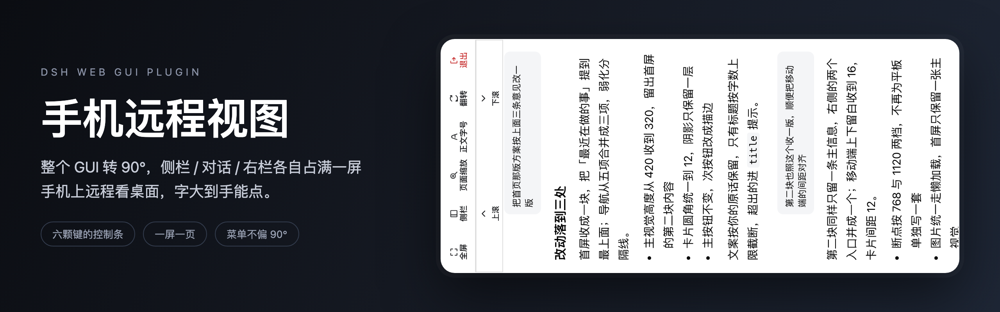
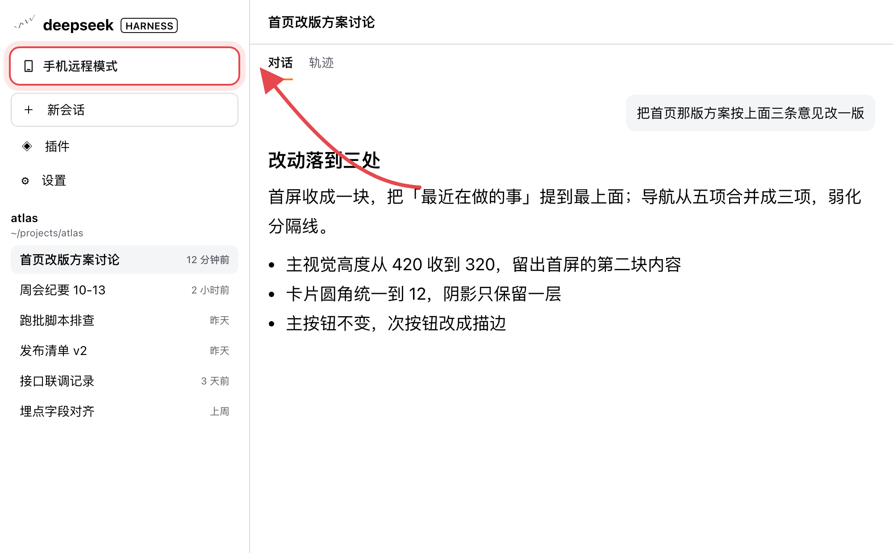
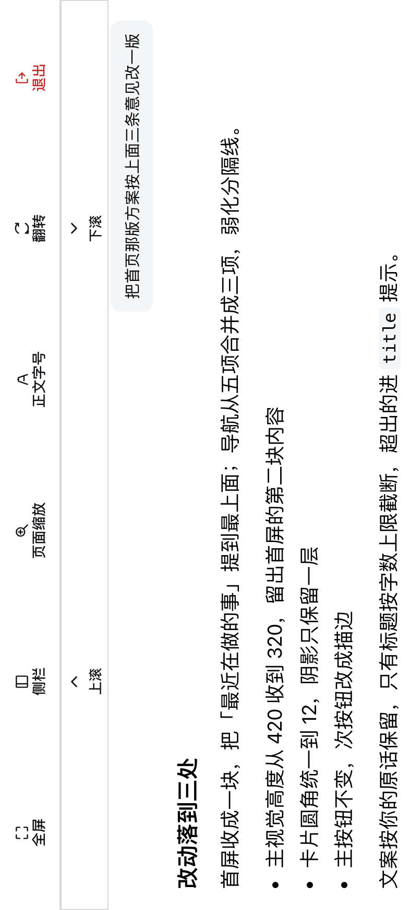
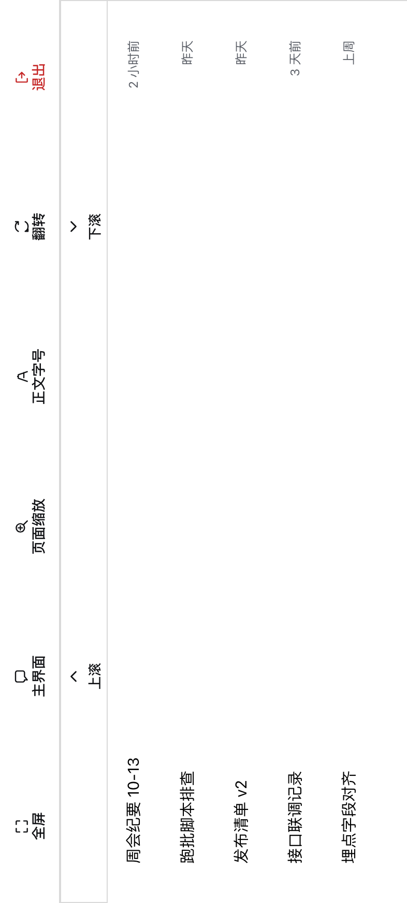
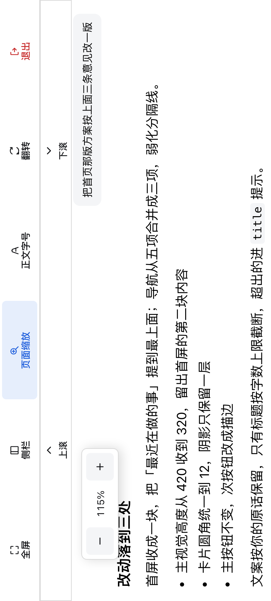
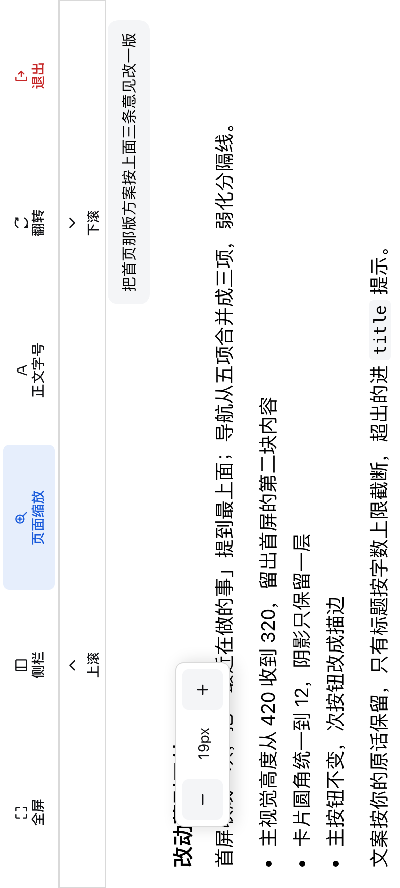
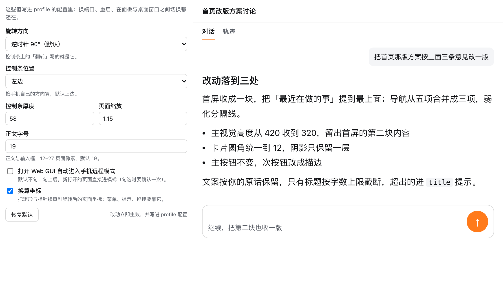
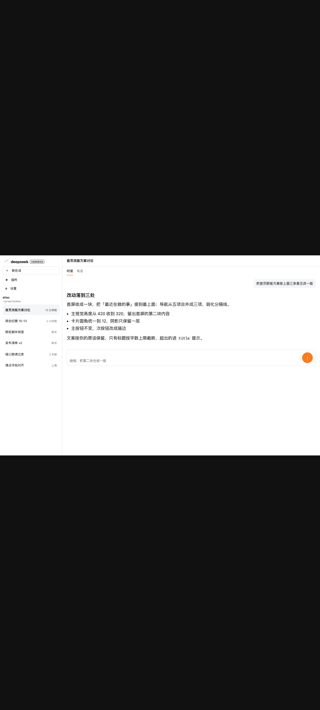

<div align="center">



# dsh-mobile-remote-view

把 DSH Web GUI 整个转 90°，**侧栏 / 对话 / 右栏各自占满一屏** —— 手机远程看桌面时，字大到手能点。

中文 / [English](README.en.md)

[它解决什么问题](#它解决什么问题) · [做出来的样子](#做出来的样子) · [安装](#安装) · [配置](#配置) · [技术要点](#技术要点) · [开发](#开发)

<p>
  
  
  
  
  
  
</p>

</div>

***

## 它解决什么问题

电脑上跑着 DSH，人不在电脑旁，用手机远程看那块横屏桌面：远程工具把整个横屏压进竖屏，三栏挤在一起，正文小到点不准。

这个插件把整个 GUI 逆时针转 90°，让它按竖屏的形状重新排版，再把「一次只看一块区域」做成页面切换。

- **给谁用**：用手机远程看自己桌面 DSH 的人，以及在小窗口里开桌面版 DSH 的人。
- **解决什么**：一屏只放一块区域，正文 19px 起；发送与审批按钮放大到 48px；不用横着放大页面去找按钮。
- **不做什么**：不改外壳的结构、不替你选会话 —— 换页只决定「现在看哪一块」，点哪一项仍由你说了算。

## 做出来的样子

### 入口就在侧栏里

<p align="center">
  
</p>

**一行「手机远程模式」**夹在 logo 行与「新会话」之间，和新会话同宽；装完默认只能从这里进 —— 想让它每次自动进，去插件卡片勾一项（见[配置](#配置)）。

### 一屏一页，控制条贴在边上

<p align="center">
  
</p>

**整个 GUI 转了过来** —— 这张就是手机屏上看到的样子：画面转了 90°，六颗键（全屏 / 页键 / 页面缩放 / 正文字号 / 翻转 / 退出）与滚动条排在一条边上，正文按手机的形状重新排版，一屏只放这一块。

### 侧栏页：整列铺满，行也变高

<p align="center">
  
</p>

**点页键切到侧栏**：外壳原本 280px 宽的那一列被撑满整屏，会话行抬到 48px、面板行 44px；点会话行、点「插件」这类面板行，都会自动回到对话页。

### 右下角那条右栏，也能单独成页

右面板一打开就自动成为一页，关掉自动回到对话页；这段时间里页键写着「关闭右栏」，点一下就关。

### 缩放与字号，两颗键各带一个浮窗

<p align="center">
  
  
</p>

**点一下开、点一下收**，连点 `+` `−` 浮窗一直开着，改到满意为止；改动当场生效，同时写进 profile 配置与本地存储。

### 七个旋钮都在插件卡片上

<p align="center">
  
</p>

**侧栏「插件」→ 手机远程视图**：旋转方向、控制条位置与厚度、页面缩放、正文字号、自动进入、换算坐标。写进 profile，换端口、重启、换窗口都还在。

### 和「直接远程看」的差别

<table>
<tr>
<td width="50%" align="center"></td>
<td width="50%" align="center"></td>
</tr>
<tr>
<td align="center">直接远程看：整个桌面压进手机，正文 ≈ 8px</td>
<td align="center">手机远程模式：一屏一页，正文 19px 起</td>
</tr>
</table>

> 上面几张都是从真引擎、真浏览器里截的（用的是插件自己的样式表），里面的会话名、工作区路径与对话内容都是为截图临时编的。

## 特性

### 一屏只做一件事

主界面、侧栏、右栏同时只有一页可见，各占满整屏；页键写的是「要去哪」—— 在对话页它写着「侧栏」，在侧栏页写着「主界面」。

### 拇指尺寸

正文与输入框 12–27px（默认 19px）；发送 / 停止与审批按钮 48px 触摸目标；侧栏行 48px。

### 滚动靠两颗大键

页面纵轴横躺在手机上，手指上下滑不动画面，于是控制条旁边常驻「上滚 / 下滚」，每点一次走一屏的 70%。

### 菜单、提示、拖拽都不会偏

旋转之后所有测量 API 都换算回页面自己的坐标，弹层仍贴着触发器；这一层可以关（关掉后菜单会偏 90°）。

### 退出就还回去

点「退出」转回桌面版面，侧栏恢复到你进入前的状态；插件写在页面上的属性、样式与坐标层一并撤掉。

***

## 安装

### 环境要求

| 项 | 要求 |
| --- | --- |
| DSH | `0.2.0-rc.2`（契约按冻结底座逐条核对） |
| Node | ≥ 22.19（只在构建与安装时用到） |
| 运行依赖 | 无；宿主半需要的 schema 已内联进产物 |
| 外壳 | 官方 Web profile（提供 `layout` 服务） |

### 命令方式

```bash
cd /path/to/dsh-mobile-remote-view
node scripts/install-profile.mjs --dry-run   # 先看会改哪几个文件
node scripts/install-profile.mjs             # 装进 $DSH_HOME 的 web profile（逐文件备份）
```

### 插件页方式

装成 bundle 后，侧栏「插件」→ 已安装 里就有本插件那张卡片，右侧是宿主自己的启用 / 停用开关。本地包第一次仍需上面的脚本。

### 装完要重启引擎本身

宿主半边只在引擎进程启动时加载一次：重载编辑器窗口、重启桌面版都只是复用同一台活引擎。浏览器半的改动刷新页面即可。

## 首次使用

1. 侧栏最上方出现**「手机远程模式」**，点它。
2. 页面转 90°，控制条与滚动条出现，落在对话页；点页键切侧栏，打开右栏会自动成页。
3. 点「退出」转回桌面版面。

## 卸载

```bash
node scripts/install-profile.mjs --uninstall
```

依赖、`dsh.profile.bundles` 条目与 `node_modules` 软链一并去掉，改过的文件从备份还原，不留残余。

***

## 技术要点

下面三句讲完它是怎么成立的，更多细节在代码里。

**旋转的入口元素是 `document.documentElement`**：外壳的菜单、提示、对话框都 portal 到 `document.body`，转更小的容器它们不跟着转。app 盒尺寸 = `屏高 ÷ 缩放 × 屏宽 ÷ 缩放`，控制条与滚动条占掉一条边，剩下的才给内容。

**两套坐标系，靠一层坐标层对齐**：转动之后浏览器仍用屏幕坐标回答 `getBoundingClientRect`、指针位置与 `innerWidth`，而页面按 app 坐标排版；插件在进入模式时把这些测量 API 改成回答 app 坐标，退出时完整还原（`virtualizeCoordinates: false` 可关）。

**三块区域共用一颗页键，侧栏状态仍归外壳**：页键只在对话页与侧栏页之间切；右栏打开时它变成「关闭右栏」，通过外壳自己那颗关闭按钮收栏，以 `data-sidebar-right-open` 消失为成功信号。侧栏的展开 / 收起走外壳的 `layout.toggleSidebar()`，进入模式时记下状态、退出时恢复。

### 配置

| 项 | 类型 | 默认 | 说明 |
| --- | --- | --- | --- |
| `rotate` | `-90` \| `90` | `-90` | 整页旋转方向；控制条「翻转」写的就是它 |
| `barEdge` | `top` \| `bottom` \| `left` \| `right` | `top` | 控制条贴屏幕哪条边（按手机自己的方向） |
| `barSize` | 40–120 | `58` | 控制条厚度（页面像素） |
| `scale` | 0.6–2.5 | `1.5` | 页面整体缩放 |
| `contentFontSize` | 12–27 | `19` | 正文与输入框字号（页面像素） |
| `autoEnter` | boolean | `false` | 打开 Web GUI 自动进入模式（勾选时确认一次） |
| `virtualizeCoordinates` | boolean | `true` | 坐标层开关 |
| `globalName` | string | `__DSH_MOBILE_REMOTE_VIEW__` | 宿主注入页面的全局名 |

```yaml
# $DSH_HOME/profiles/web/cordis.patch.yml
- id: dsh-mobile-remote-view
  name: dsh-mobile-remote-view
  config:
    rotate: -90
    barEdge: left
    scale: 1.15
```

浏览器里只存两样：`sessionStorage` 的 `dsh-mobile-remote-view:v1`（是否在模式中、当前哪一页；刷新还在，关掉标签页就重来）与 `localStorage` 的 `dsh-mobile-remote-view:prefs`（缩放与字号的本地副本，只在引擎没有设置接口时当初值）。

### 目录结构

```text
src/
├── index.ts                    # 宿主入口：只挑 Loader 能看见的导出
├── constants/  enums/  types/  utils/   # 范围与默认值、枚举、共享类型、几何与存储
├── host/                       # 宿主半：schema、发布、apply
└── client/                     # 浏览器半
    ├── index.ts                # 装配：控制器 + 设置表单 + 插件卡片
    ├── components/             # 控制条、滚动条、浮窗、入口按钮、提示、卡片
    ├── services/               # 状态机控制器、全屏能力
    ├── utils/                  # 区域定位、坐标层、页键三态
    └── styles.ts               # 模式的整页样式表
assets/                         # 本文档用到的截图（内容为截图临时编的）
test/                           # 49 项 node:test 单测（含打包冒烟）
scripts/install-profile.mjs      # 装成 profile bundle / 还原
```

### 已知限制

- 「全屏」靠页面自己的 Fullscreen API；iOS Safari 不给元素级全屏，那颗键不出现。
- 软键盘遮挡不在范围内，输入按浏览器原生行为处理。
- `Selection` / `Range` 的矩形没有改写，用它的浮层会偏 90°。
- 会话行的判定同时认 `data-session-id` 与 `data-row-key="session:…"`；外壳再换写法就要跟着换。

## 开发

```bash
npm install          # esbuild + typescript + schemastery（构建期）
npm run build        # lib/index.js（宿主）+ lib/client.js（module-table 方言的浏览器半）
npm run watch        # 改一处编一处
npm run typecheck    # tsc --noEmit，严格模式，覆盖两个半边
npm test             # 49 项单测：几何、配置收窄、存储、schema、发布、坐标层、页键三态、外壳契约、样式表、打包冒烟
```

最短本地闭环：`npm run build` → 刷新页面（浏览器半即时生效）；改了宿主半要重启引擎本身。

***

## FAQ

**装了没反应？** 先确认 profile 的 `dsh.profile.bundles` 里有它、`node_modules` 软链指向本目录，再确认**重启的是引擎本身**（重载窗口不算）。

**卡片只读？** 卡片顶部会写明是哪一种：注入里没有旋钮 = 引擎跑的还是旧宿主半边，重启引擎即可；旋钮都在、只是没有设置传输 = 这台引擎确实没有这个服务，控制条仍然可用，只是改动只对当前页面有效。

**菜单跑到离触发器一个 90° 的地方？** 坐标层被关了，打开「换算坐标」即可。

**点侧栏不切回对话页？** 外壳换了会话行的标记写法。当前版本同时认两种，再换就要更新判定。

## Roadmap

- **0.1.0（已完成）**：整页旋转、三页切换与一颗页键、右栏跟随、控制条与滚动条、缩放 / 字号浮窗、坐标层、拇指尺寸、插件卡片七旋钮、装成 profile bundle。
- **计划中**：横向平板的条子位置预设、软键盘遮挡适配、一次性 `DSH_HOME` + 无头 Chromium 的端到端脚本。

## 贡献

Issue 说清三件事：DSH 版本、复现步骤、期望行为；UI 问题带上截图与当时的缩放 / 旋转档位。PR 保持单一意图，先跑 `npm run typecheck && npm test`，新增能力补一条能独立跑的测试。

外部 PR 一律先签 CLA 再合并 —— 没有这一步，本项目以后无法双许可或换协议。

## License

MIT（见 [LICENSE](LICENSE)）。

宿主产物内联了 `@deepseek-ai/schemastery`（MIT），转载请保留 [THIRD_PARTY_NOTICES.md](THIRD_PARTY_NOTICES.md) 里的声明。

截图说明：`assets/` 里的图都是本插件真实样式在浏览器里渲染出来的；里面的会话名、工作区路径与对话内容是为截图临时编的，与任何真实账号或机器无关。
